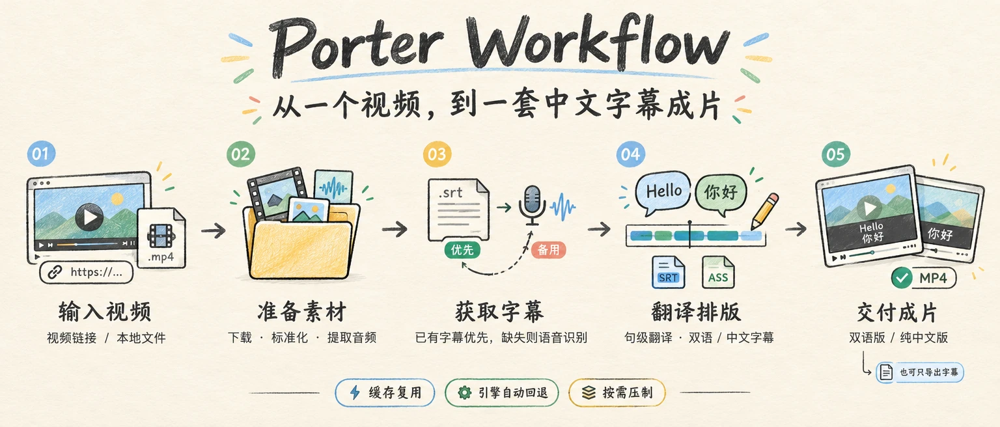

<h1 align="center">Porter Workflow</h1>

<p align="center">
  <b>English</b> | <a href="README.zh-CN.md">简体中文</a>
</p>

<p align="center">
  <a href="https://github.com/RolinShmily/porter-workflow/actions/workflows/test.yml"></a>
  <a href="https://pypi.org/project/porter-workflow/"></a>
  <a href="https://pypi.org/project/porter-workflow/"></a>
  
  <a href="LICENSE"></a>
</p>

<p align="center">
  
</p>

**Porter Workflow** turns video URLs (YouTube, Bilibili, TikTok, X/Twitter, Instagram) or
local media/subtitles into bilingual & Chinese subtitles and hard-subbed MP4s. Plan first,
one capability per stage (no silent runtime fallback); offline Whisper (`faster-whisper`),
key-free translation, LLM adapters, and `1080p` target quality ship in the base package,
while Gradio stays optional in `[web]`.

## Prerequisites

- **Python 3.11–3.13** (or [`uv`](https://docs.astral.sh/uv/))
- **FFmpeg + ffprobe** with **`libass`** on `PATH` (`ffmpeg -filters | grep subtitles`)
- **Deno** (recommended) or **Node ≥ 20** on `PATH` for YouTube

## Quickstart

### WebUI Workbench

```bash
uv tool install "porter-workflow[web]" && porter   # http://127.0.0.1:7860
# or run without installing:
uvx --from "porter-workflow[web]" porter
```

### Agent Skill

```bash
npx skills add RolinShmily/porter-workflow
```

Installs [`skills/porter-workflow/`](skills/porter-workflow/SKILL.md) — a self-contained JSON CLI over the
published PyPI package (auto-bootstrapped via `uv`).

### Python Core API

```bash
pip install porter-workflow
```

```python
from porter import plan_source, run_plan

plan = plan_source("https://www.youtube.com/watch?v=...", quality="1080p", burn="dual")
if plan.feasible:
    print(run_plan(plan).workflow.artifacts)
```

## Supported Sources

| Source | Examples | Native Subtitles | Notes |
| --- | --- | --- | --- |
| YouTube | `youtube.com`, `youtu.be` | Yes | Needs Deno or Node ≥ 20 |
| Bilibili | `bilibili.com`, `b23.tv` | Yes | High quality / CC may need cookies |
| TikTok | `tiktok.com`, `vm.tiktok.com` | Yes | — |
| X / Twitter | `x.com`, `twitter.com` | No | Uses ASR (`faster-whisper` by default) |
| Instagram | `instagram.com` | No | Uses ASR; gated reels may need cookies |
| Local files | `.mp4` / `.wav` / `.srt` / `.vtt` | Optional (`--subtitle-file`) | Subtitles run without FFmpeg |

## Output Layout

```text
porter_output/<video_id>_<safe_title>/
├── raw/        video.mp4, audio.wav, transcript.json/.txt, subtitle.srt, cover.jpg, metadata.json
├── cooked/     subtitle_{bilingual,zh}.{srt,ass}, video_{bilingual,zh}.mp4
└── .tmp/       scratch (safe to delete between runs)
```

## Documentation

| Document | Scope |
| --- | --- |
| [`docs/architecture.md`](docs/architecture.md) | Layers, workflow & pipeline, media, subtitles, and jobs |
| [`docs/design.md`](docs/design.md) | Architectural rationale & key trade-offs |
| [`docs/reference.md`](docs/reference.md) | Python API (`import porter`), WebUI CLI flags & Skill reference links |
| [`docs/development.md`](docs/development.md) | Setup, four gates, extending, licence rules, and release |

Also see [`skills/porter-workflow/SKILL.md`](skills/porter-workflow/SKILL.md), [`CONTRIBUTING.md`](CONTRIBUTING.md), and [`CHANGELOG.md`](CHANGELOG.md).

## Acknowledgements

Built on and inspired by [yt-dlp](https://github.com/yt-dlp/yt-dlp),
[FFmpeg](https://ffmpeg.org/) & [libass](https://github.com/libass/libass),
[faster-whisper](https://github.com/SYSTRAN/faster-whisper),
[VideoCaptioner](https://github.com/WEIFENG2333/VideoCaptioner),
[Gradio](https://github.com/gradio-app/gradio), and
[Pydantic](https://github.com/pydantic/pydantic).

## License

MIT — see [`LICENSE`](LICENSE).
