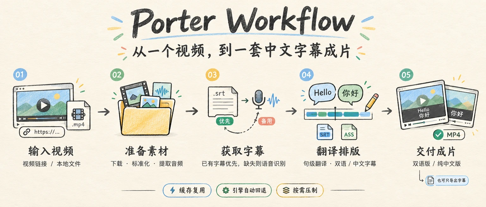

<h1 align="center">Porter Workflow（流媒体搬运工）</h1>

<p align="center">
  <a href="README.md">English</a> | <b>简体中文</b>
</p>

<p align="center">
  <a href="https://github.com/RolinShmily/porter-workflow/actions/workflows/test.yml"></a>
  <a href="https://pypi.org/project/porter-workflow/"></a>
  <a href="https://pypi.org/project/porter-workflow/"></a>
  
  <a href="LICENSE"></a>
</p>

<p align="center">
  
</p>

**Porter Workflow** 将视频链接（YouTube、Bilibili、TikTok、X/Twitter、Instagram）或
本地音视频/字幕转为双语及中文字幕与硬字幕 MP4。先计划后执行，每阶段锁定唯一能力（无运行期
静默回退）；离线本地 Whisper（`faster-whisper`）、免 Key 翻译、LLM 适配器与 `1080p`
目标画质内置于基础包，仅 Gradio 留在 `[web]` 扩展。

## 环境要求

- **Python 3.11–3.13**（或 [`uv`](https://docs.astral.sh/uv/)）
- `PATH` 上带 **`libass`** 的 **FFmpeg + ffprobe**（`ffmpeg -filters | grep subtitles`）
- YouTube 下载需 **Deno**（推荐）或 **Node ≥ 20**

## 快速上手

### WebUI 工作台

```bash
uv tool install "porter-workflow[web]" && porter   # http://127.0.0.1:7860
# 或免安装直接拉起：
uvx --from "porter-workflow[web]" porter
```

### Agent Skill

```bash
npx skills add RolinShmily/porter-workflow
```

安装 [`skills/porter-workflow/`](skills/porter-workflow/SKILL.md)——面向 PyPI 核心包的自包含纯 JSON CLI（缺环境时由 `uv` 自动拉起）。

### Python 核心 API

```bash
pip install porter-workflow
```

```python
from porter import plan_source, run_plan

plan = plan_source("https://www.youtube.com/watch?v=...", quality="1080p", burn="dual")
if plan.feasible:
    print(run_plan(plan).workflow.artifacts)
```

## 支持的输入源

| 平台 / 类型 | 示例 | 原生字幕轨 | 说明 |
| --- | --- | --- | --- |
| YouTube | `youtube.com`、`youtu.be` | 有 | 需 Deno 或 Node ≥ 20 |
| Bilibili | `bilibili.com`、`b23.tv` | 有 | 高清 / CC 字幕可能需要 cookies |
| TikTok | `tiktok.com`、`vm.tiktok.com` | 有 | — |
| X / Twitter | `x.com`、`twitter.com` | 无 | 自动走 ASR（默认本地 `faster-whisper`） |
| Instagram | `instagram.com` | 无 | 自动走 ASR；受限内容可能需要 cookies |
| 本地文件 | `.mp4` / `.wav` / `.srt` / `.vtt` | 可选（`--subtitle-file`） | 纯字幕输入无需 FFmpeg |

## 输出目录

```text
porter_output/<video_id>_<safe_title>/
├── raw/        video.mp4, audio.wav, transcript.json/.txt, subtitle.srt, cover.jpg, metadata.json
├── cooked/     subtitle_{bilingual,zh}.{srt,ass}, video_{bilingual,zh}.mp4
└── .tmp/       临时文件（两次运行间可安全清理）
```

## 文档导航

| 文档 | 内容 |
| --- | --- |
| [`docs/architecture.md`](docs/architecture.md) | 分层架构、工作流与管线、媒体层、字幕重构与作业管理 |
| [`docs/design.md`](docs/design.md) | 架构设计思路与核心权衡 |
| [`docs/reference.md`](docs/reference.md) | Python 公开 API、WebUI 启动参数与 Skill 参考索引 |
| [`docs/development.md`](docs/development.md) | 环境搭建、四道门禁、扩展点、许可证规则与发布流程 |

另见 [`skills/porter-workflow/SKILL.md`](skills/porter-workflow/SKILL.md)、[`CONTRIBUTING.md`](CONTRIBUTING.md) 与 [`CHANGELOG.md`](CHANGELOG.md)。

## 致谢

感谢 [yt-dlp](https://github.com/yt-dlp/yt-dlp)、
[FFmpeg](https://ffmpeg.org/) & [libass](https://github.com/libass/libass)、
[faster-whisper](https://github.com/SYSTRAN/faster-whisper)、
[VideoCaptioner](https://github.com/WEIFENG2333/VideoCaptioner)、
[Gradio](https://github.com/gradio-app/gradio) 与
[Pydantic](https://github.com/pydantic/pydantic) 等开源项目。

## 许可证

MIT — 见 [`LICENSE`](LICENSE)。
