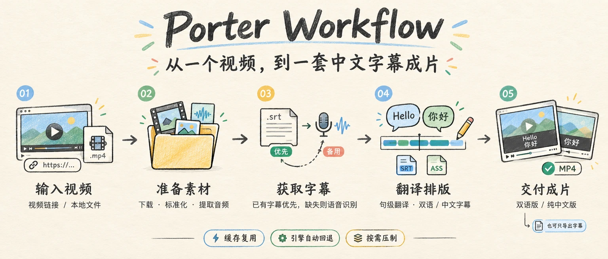

<h1 align="center">Porter Workflow（流媒体搬运工）</h1>

<p align="center">
  <a href="README.md">English</a> | <b>简体中文</b>
</p>

<p align="center">
  <a href="https://github.com/RolinShmily/porter-workflow/actions/workflows/test.yml"></a>
  <a href="https://pypi.org/project/porter-workflow/"></a>
  
  <a href="LICENSE"></a>
</p>

<p align="center">
  
</p>

**Porter Workflow** 接收一个视频链接或本地文件，产出一套本地化成品：标准化素材、
双语与纯中文字幕，以及烧好硬字幕的 MP4。

## 整体流程

```text
视频链接 / 本地文件
      │
      ▼
PREPARE     下载、标准化、抓取平台字幕、抽取音频
      │
      ▼
TRANSCRIBE  使用平台字幕轨，或运行语音识别
      │
      ▼
TRANSLATE   生成目标语言字幕（默认 zh-Hans）
      │
      ▼
BURN        输出双语 / 纯中文硬字幕 MP4
```

重跑时会复用已完成的阶段。`--force` 强制重做，`--only-phase` 执行到指定阶段为止，
`--burn skip` 只出字幕、不压制。

### 支持的平台

| 平台 | 链接示例 | 平台字幕轨 |
| --- | --- | --- |
| YouTube | `youtube.com`、`youtu.be` | 有 |
| Bilibili | `bilibili.com`、`b23.tv`、`bilibili.tv` | 有（CC 可能需要 cookies） |
| TikTok | `tiktok.com`、`vm.tiktok.com` | 有 |
| X / Twitter | `x.com`、`twitter.com` | 无——走 ASR |
| Instagram | `instagram.com` | 无——走 ASR |
| 本地文件 | 任意可读路径 | 无——走 ASR 或 `--subtitle-file` |

下载统一走 yt-dlp，因此它支持的其他站点也可能可用，但只有上述平台有显式规格。
平台字幕轨是**请求而非保证**：限流会让抓取失败，此时自动回退到 ASR。

## 各阶段的可用方式

### PREPARE

- **链接**——yt-dlp 下载；**本地文件**——直接使用。
- **FFmpeg** 把视频标准化为 H.264/AAC，音频转为 16 kHz 单声道。
- YouTube 建议安装 **Deno**（或 Node ≥ 20），用于 yt-dlp 的 JS 挑战。

### TRANSCRIBE

| 方式 | 前提 | 说明 |
| --- | --- | --- |
| 平台字幕 | —— | 免费且准确；平台提供时优先使用 |
| `whisper-local` | `[asr-local]` extra | 免 Key；模型下载后可离线，排在链首 |
| `whisper-api` | `[llm]` extra + API Key | 任意 OpenAI 兼容的 `/audio/transcriptions` 端点 |
| `videocaptioner` | 自行安装的外部 CLI | GPL-3.0 且 `python<3.13`，因此不是声明依赖 |
| `--subtitle-file FILE` | 本地 SRT | 显式指定源字幕，跳过平台轨与 ASR |

第一个可用后端胜出。`--asr-engine NAME` 把指定后端提到最前，其余仍作为回退。
平台自带中文字幕轨时，翻译阶段会整体跳过。

### TRANSLATE

| 方式 | 前提 | 说明 |
| --- | --- | --- |
| `llm` | `[llm]` extra + API Key | 质量最好，还能顺带修 ASR 错误 |
| `bing` | 无 | 免 Key 端点 |
| `google` | 无 | 免 Key 端点 |
| `mymemory` | 无 | 有文档的公开 API |
| `videocaptioner-llm` | 外部 CLI | GPL-3.0，需自行安装 |
| `videocaptioner` | 外部 CLI | GPL-3.0，需自行安装 |

第一个产出可用文本的后端胜出。目标语言为中文时，返回内容若不含 CJK 字符会被判定
为失败并尝试下一个后端。`--translator NAME` 与 `--asr-engine` 语义相同：提到最前，
不作过滤。`--target-lang` 默认 `zh-Hans`。

### BURN

| 模式 | 产物 |
| --- | --- |
| `dual`（默认） | `video_bilingual.mp4` + `video_zh.mp4` |
| `zh_only` | `video_zh.mp4` |
| `bilingual_only` | `video_bilingual.mp4` |
| `skip` | 只出字幕，不压制视频 |

压制依赖 **带 libass 的 FFmpeg**。字体、字号、颜色、边距与淡入淡出在 `style`
配置段中调整。

## 安装

需要 **Python ≥ 3.11**。

以下**不是** Python 包，必须在 `PATH` 上：

| 依赖 | 用途 | 说明 |
| --- | --- | --- |
| **FFmpeg + ffprobe** | 全部功能 | 必须**编译了 libass**。验证：`ffmpeg -filters \| grep subtitles` |
| **Deno**（推荐） | YouTube 下载 | yt-dlp ≥ 2025.11.12 需要外部 JS 运行时；Node ≥ 20 亦可 |

```bash
# 推荐：本地、免 Key、可离线转录
uvx --from "porter-workflow[asr-local]" porter "<URL>"

# 全部可选后端（含 WebUI 依赖）
uvx --from "porter-workflow[all]" porter "<URL>"

# WebUI 工作台
uvx --from "porter-workflow[web]" porter-web

# 持久安装
pipx install "porter-workflow[all]"

# 环境检查
porter doctor
```

| Extra | 引入 | 用途 |
| --- | --- | --- |
| `[asr-local]` | `faster-whisper` | 本地 Whisper——免 Key、可离线 |
| `[llm]` | `openai`、`json-repair` | LLM 翻译 + Whisper API 识别 |
| `[images]` | `pillow` | 封面图处理 |
| `[mcp]` | `fastmcp` | `porter-mcp` 服务端 |
| `[web]` | `gradio` | `porter-web` 工作台 |
| `[all]` | 以上全部 | —— |

最小安装（不含 `[asr-local]` 或 `[llm]`）可以下载和翻译，但只有平台字幕存在、
或已安装外部 VideoCaptioner CLI 时才能转录。`porter doctor` 会报告任务实际会走
哪条路。

## 用法

```bash
porter inspect "<URL>"              # 预检链接，不产生下载
porter plan "<URL>"                 # 显示实际路线与预期失败点
porter "<URL>"                      # 完整流水线
porter "<URL>" -o ./porter_output   # 指定输出目录
porter "<URL>" --burn skip          # 只出字幕
porter doctor                       # 环境诊断
porter config list                  # 查看生效配置（密钥脱敏）
```

### 输出目录

```text
<output_dir>/<video_id>_<safe_title>/
├── raw/
│   ├── video.mp4                 H.264 + AAC + faststart 母版
│   ├── audio.wav                 16 kHz 单声道基准音轨
│   ├── audio_enhanced.wav        仅用于 ASR 的降噪音轨
│   ├── transcript.json/.txt      重建后的整句台词本
│   ├── subtitle.srt              平台原生字幕（若有）
│   ├── cover.jpg
│   └── metadata.json
└── cooked/
    ├── subtitle_bilingual.{srt,ass}
    ├── subtitle_zh.{srt,ass}
    ├── video_bilingual.mp4
    └── video_zh.mp4
```

### 前端入口

| 前端 | 命令 | 面向 |
| --- | --- | --- |
| CLI | `porter` | 人类与 Shell 脚本 |
| MCP | `uvx --from "porter-workflow[mcp]" porter-mcp` | 通过 stdio JSON-RPC 接入的 AI 智能体 |
| WebUI | `uvx --from "porter-workflow[web]" porter-web` | 使用人机协同工作台的人类与智能体 |
| Agent Skill | `npx skills add RolinShmily/porter-workflow` | 使用 Agent Skills 规范的智能体 |

四者调用同一个引擎。MCP 配置见
[`skills/porter-skill/references/MCP.md`](skills/porter-skill/references/MCP.md)；
受限 Windows 宿主见
[`skills/porter-skill/references/HOSTS.md`](skills/porter-skill/references/HOSTS.md)。

## 配置

按以下顺序解析，优先级由高到低：

1. `--config <path>`
2. `$PORTER_CONFIG`
3. 环境变量（覆盖所选文件中的对应键）
4. 最近的项目配置：`porter.json` → `porter.toml` → `config.json`
5. 用户级配置目录（仅当没有项目配置）
6. 内置默认值

| 配置段 | 键 | 作用 |
| --- | --- | --- |
| 顶层 | `output_dir`、`cookies_file`、`cookies_browser` | 输出位置与受限媒体访问 |
| `llm` | `api_key`、`api_base`、`model` | LLM 翻译、文本精炼与 Whisper API 兜底 |
| `asr` | `engine`、`language`、`audio_denoise`、`whisper_local_model`、`whisper_local_device`、`whisper_local_compute_type`、`whisper_api_key`、`whisper_api_base`、`whisper_model` | 语音识别 |
| `refine` | `enabled`、`model` | 翻译前的 LLM 转录校对 |
| `ffmpeg` | `ffmpeg_path`、`ffprobe_path`、`video_codec`、`preset`、`crf`、`pixel_format`、`audio_codec`、`audio_bitrate`、`audio_sample_rate`、`wav_sample_rate`、`auto_tune` | 编码与硬件调优 |
| `style` | `zh_font`、`en_font`、字号、颜色、`outline_*`、`shadow`、`margin_*`、`fade_*` | ASS 字幕外观 |

```bash
porter config list                     # 生效值 + 来源，密钥脱敏
porter config get llm                  # 查看某一段
porter config set llm.model=deepseek-chat
porter config set llm.api_key=sk-...   # 默认写入用户级配置
```

完整键表、默认值与示例见
[`skills/porter-skill/references/CONFIG.md`](skills/porter-skill/references/CONFIG.md)。

## 构建与开发

开发需要 **Python 3.11–3.13**、**uv**、**FFmpeg + libass**，以及 **Deno** 或
**Node ≥ 20**。运行时依赖只有 `yt-dlp[default]`、`requests`、`pydantic` 和
`platformdirs`，其余都是可选 extra。

```bash
uv sync --extra all --extra dev      # 严格按 uv.lock 安装

ruff check src tests scripts        # 含 T20：引擎禁止 print()
mypy src scripts                    # strict 类型检查
lint-imports                        # 引擎/前端依赖契约
pytest -m "not network"             # 离线测试
```

仓库结构：

```text
src/porter/
├── __init__.py       稳定公开 API（懒加载）与 __version__
├── core/             引擎——全部业务逻辑
├── cli/              CLI 前端
├── mcp/              MCP 前端
└── webui/            Gradio WebUI 前端（人机协同工作台）
skills/porter-skill/  Agent Skill 资产（SKILL.md、scripts、references）
scripts/              开发/发布辅助脚本（launcher.py）
docs/                 开发、架构、参考、设计、图片
tests/{unit,regression,integration}/
```

- [文档中心](docs/README.md)
- [架构总览](docs/architecture/overview.md)
- [开发门禁](docs/development/gate.md)
- [CLI 参考](docs/reference/cli.md)
- [参与贡献](CONTRIBUTING.md)

## 许可证

MIT，见 [LICENSE](LICENSE)。第三方组件及其许可证列在
[`THIRD_PARTY_NOTICES.md`](THIRD_PARTY_NOTICES.md)。
